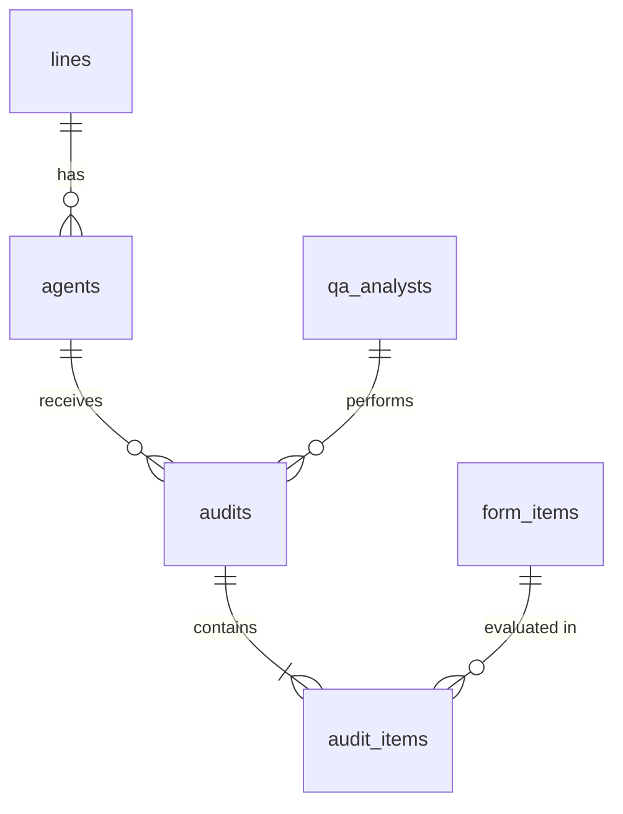
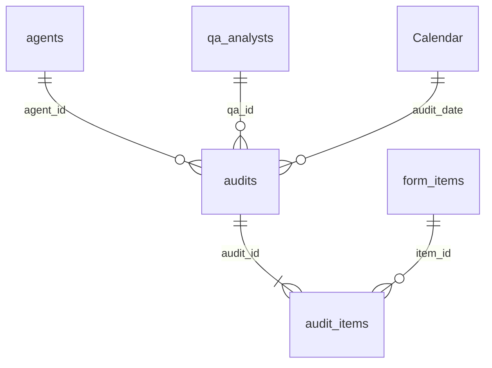

QA Analytics Lab

SQL analysis of a quality assurance (QA) operation in a BPO setting, covering 500 agents, 25 QA analysts, 6 lines of business and 90,000 audits over 12 weeks.

The project asks four questions a Quality Team Lead deals with every week:

Which lines of business carry the most quality risk?
Are QA analysts calibrated, or do some score much stricter or more leniently than the team?
Is quality actually improving over time?
How much does agent tenure affect quality?

Note: All data is synthetic, generated with Python (src/generate_data.py). It is modeled on how real BPO quality operations work, but it contains no real people, clients or company data.

Tech stack
Python (pandas, NumPy, Faker): reproducible synthetic data generation
SQLite: relational database
SQL: JOINs, CTEs, window functions (AVG() OVER, RANK, LAG, PARTITION BY), CASE and date functions
Git and GitHub: version control
Data model
```

Table	Description	Rows
lines	Lines of business and their channel	6
agents	Agents, with line, team leader and hire date	500
qa_analysts	QA analysts	25
form_items	Quality form items, with weight, category and critical flag	10
audits	Fact table: one row per audit, with score and critical error flag	90,000
audit_items	Pass/fail result for each form item in each audit	900,000

Scoring rule: 100 minus the weights of the failed items. Any critical error sets the score to 0.

Key findings
1. Live Streams is the highest-risk line
Line	Avg score	Critical errors
Marketplace Safety	91.5	4.9%
Ads Review	87.3	7.2%
Customer Care	86.6	7.6%
Trust & Safety Appeals	84.9	8.5%
Payments Support	83.3	9.6%
Live Streams	80.7	10.9%

Live Streams has more than twice the critical error rate of the best line.

2. Calibration problems exist in both directions

Using a ±3-point threshold against the team average:

1 analyst is too strict (−5.3 points). An item-level breakdown shows the gap is evenly spread across all form items (about 40% higher fail rate on every item). That points to a shifted personal standard, not one ambiguous rubric item.
3 analysts are too lenient (+3.1 to +3.6 points). This is the bigger business risk, because lenient scoring lets errors reach the client without being reported.

Limitation: the team average is not the ground truth. A proper calibration should compare analysts against an expert reference ("gold standard") audit.

3. Quality improved steadily, and the improvement is real
The average score rose from 83.7 to 87.6 (+3.9 points) in 12 weeks.
The critical error rate dropped from 9.3% to 7.2%.
Week-over-week dips of about 0.1 points are within normal noise at 7,500 audits per week.
4. New hires score about 8 points lower
Agent tenure	Avg score	Critical errors
0–89 days	77–79	11.6–12.6%
90+ days	85–87	7.3–8.9%

New hires account for only about 3.5% of audits. Even if all of them improved by 8 points, that would add only about 0.3 points to the overall score, so most of the overall improvement is not explained by new hires maturing.

Recommendations
Live Streams: prioritize coaching and policy refreshers on its most-failed critical items.
Calibration: run sessions that include both the strictest and the most lenient analysts, scored against expert reference audits.
New hires: add extra audits and targeted feedback during the first 90 days.
Monitoring: replace the fixed ±3 threshold with a statistical rule (standard deviation) and track it weekly.
How to run
bash
python -m venv .venv
.venv\Scripts\activate          # Windows
pip install -r requirements.txt

python src/generate_data.py                          # creates data/qa_lab.db
python src/run_query.py sql/01_overview.sql          # run any query
## Project structure

```
qa-analytics-lab/
├── src/
│   ├── generate_data.py      # synthetic data generator
│   └── run_query.py          # runs a .sql file and prints the result
├── sql/
│   ├── 01_overview.sql             # score and critical errors by line
│   ├── 02_qa_calibration.sql       # QA analysts vs team average (CTE)
│   ├── 03_qa_item_gap.sql          # item-level gap for one analyst (window function)
│   ├── 04_calibration_flags.sql    # automatic flags (RANK, CASE)
│   ├── 05_weekly_trend.sql         # week-over-week trend (LAG)
│   ├── 06_weekly_trend_by_qa.sql   # trend per analyst (PARTITION BY)
│   └── 07_tenure.sql               # quality by agent tenure
└── data/                     # generated database (not tracked by Git)
│   ├── export_csv.py         # exports tables to CSV for Power BI
├── powerbi/
│   └── qa-dashboard.pbix     # Power BI model and dashboard
```

---

## Power BI dashboard

The same data is modeled in Power BI as a **star schema**, with `audits` as the fact table.



**Modeling decisions**
- `lines` was merged into `agents` in Power Query, which turns a snowflake into a star.
- A DAX `Calendar` table is marked as the date table, which enables time intelligence.
- Foreign keys are hidden in the fact tables, so all filters come from the dimensions.

**Key DAX measures**

| Measure | Purpose |
|---|---|
| `Avg Score`, `Critical Error %`, `Item Fail %` | Core quality KPIs |
| `Gap to Target`, `Score Status` | Distance to an adjustable target (what-if parameter, default 95) |
| `Score Color` | Conditional formatting: on target / at risk (within 5 points) / below target |
| `Avg Score Prev Week`, `WoW Change` | Week-over-week trend using `DATEADD` |

All measures were validated against the SQL results (for example, Live Streams: 80.67 avg score and 10.9% critical errors in both tools).

*Dashboard screenshots coming soon.*
Next steps
 - [x] Power BI dashboard on this data (star schema, DAX measures, alerts) 
- [ ] AI QA Copilot: score interactions with an LLM against the quality form


Author: Miguel Ordoñez Torres, Quality Team Lead · LinkedIn